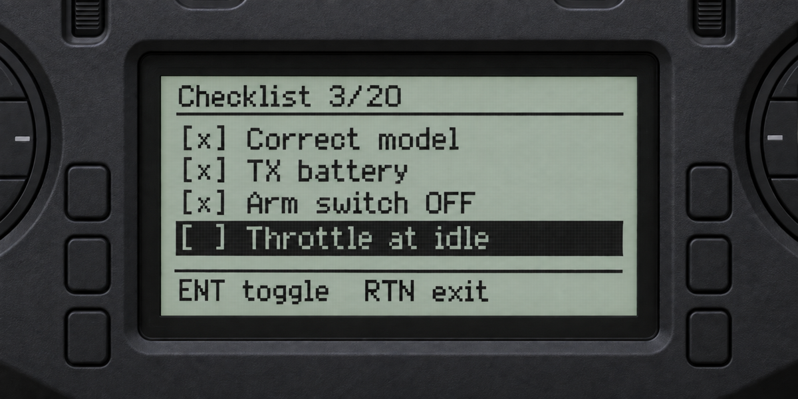

# EdgeTX preflight checklist

A small, read-only checklist tool for a Jumper T14 running EdgeTX 2.11.

Tested on a **Jumper T14 running EdgeTX 2.11.3**.



## Install

Copy these two files to the radio SD card:

- `Checklist.lua` to `/SCRIPTS/TOOLS/Checklist.lua`
- `checklist.md` to `/SCRIPTS/TOOLS/checklist.md`

To make the checklist available as a model DISPLAY screen, also copy:

- `chklst.lua` to `/SCRIPTS/TELEMETRY/chklst.lua`

Open **System > Tools > Checklist** on the radio.

Alternatively, open the model's **DISPLAY** settings, set a screen type to
**Script**, and select `chklst`. The telemetry filename is intentionally six
characters because that is the limit for monochrome EdgeTX display scripts.

## Controls

- Use the roller or navigation keys to select a task.
- Press **ENT** to mark or unmark it.
- Press **RTN** to close the checklist.

Completion is intentionally kept only in memory. Closing and reopening the tool
starts a fresh checklist and never changes `checklist.md`.

Checking an item plays a three-note ascending confirmation, while unchecking it
plays a low tick. Completing the final unchecked task plays a longer eight-note
celebratory melody.

## Edit the checklist

Edit `checklist.md` on a computer. The tool recognizes standard Markdown task
lines such as:

```markdown
- [ ] Check the control surfaces
- [ ] Confirm the launch area is clear
```

Headings and ordinary Markdown text are ignored by the radio, so they may be
used to organize or document the file. Both `[ ]` and `[x]` lines are accepted,
but every task starts unchecked when the tool opens.

The file may contain up to 64 tasks and must not exceed 16 KiB. Keep task text
concise for the radio's 128x64 display; longer text wraps to a second line and is
then shortened with an ellipsis.

The layout deliberately uses the T14 monochrome font metrics and does not rely
on the color-radio `lcd.sizeText` API.
